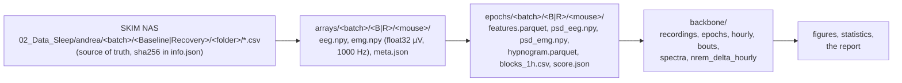

# HLB EEG sleep data: the backbone for figures

> [!abstract] TL;DR
> Every figure about HLB EEG sleep starts from **one folder of long tables**,
> `~/sleep-data/hlb-rescore-2026-11/backbone/` (ThinkPad, 2026-11-03), keyed by
> `batch · mouse · tp · epoch` (or `zt_hour`). They are rebuilt from the NAS CSVs by four scripts;
> nothing in them is typed by hand. Read `recordings.csv` first: it says which mouse-window is in
> which **tier**, and only tiers A/B carry W / NR / R.
>
> Method: [[hlb-eeg-scoring-method-2026-11]]. Results: [[hlb-eeg-sleep-overview]]. Rerun: [[hlb-eeg-compute-runbook]].

## The chain



| step | script (`eeg-emg-analysis/rescore_2026_11/`) | output under `~/sleep-data/hlb-rescore-2026-11/` | size |
|---|---|---|---|
| 0 ingest | `ingest.py` | `arrays/` | ≈ 0.7 GB per mouse-window, 44 GB in all |
| A features | `features.py` | `epochs/…/features.parquet`, `psd_eeg.npy`, `psd_emg.npy` | ≈ 50 MB per mouse-window |
| B+C screen and stage | `score.py` | `epochs/…/hypnogram.parquet`, `blocks_1h.csv`, `score.json`, `epochs/screen_summary.csv` | small |
| D backbone | `backbone.py` | `backbone/*.csv`, `backbone/epochs.parquet` | ≈ 100 MB |
| review figures | `review_pack.py` | `review/<MOUSE>_<B|R>_{overview,epochs}.png`, `contested_epochs.csv` | 128 PNGs |

The arrays and epochs folders are working copies and can be deleted; the backbone can always be
rebuilt from the NAS. Where the finished backbone goes on the NAS is Andrea's decision
(see Open items in [[hlb-eeg-sleep-overview]]).

## Keys and codes (every table)

| column | values |
|---|---|
| `batch` | `HLBWSD`, `HLBSSD`, `HLBWSL`, `HLBSSL` |
| `liquid` | `water` (W…) or `SOD1` (S…), from tethering on, so every baseline is on treatment |
| `protocol` | `SD` (4 h deprivation 09:00–13:00 daily) or `SL` (ad libitum) |
| `mouse` | the Registry ID, e.g. `HLBWSD08`. Every batch is new mice |
| `tp` | `B` baseline window (09:00 → 09:00) or `R` recovery window (09:00 → 09:00 SL; 13:00 → 09:00 SD) |
| `epoch` | 1-based 4-s epoch inside the window |
| `t_kst` | epoch start, KST (naive datetime) |
| `zt_h` / `zt_hour` | hours since 09:00 lights on; light = ZT 0–12 |
| stages | `W`, `NR`, `R`; `X` artifact or not stageable; `U` unstaged; EEG-only uses `NR` / `WR`; EMG-only `W` / `S` |
| `tier` | `A`, `B`, `C`, `D`, `X` ([[hlb-eeg-scoring-method-2026-11#Usability: the tests and the tiers\|definitions]]) |

## The tables

**`recordings.csv`**, one row per mouse-window (64 rows): identity and arm; `tier`; the screen
(`eta_gap`, `eta_ss60`, `auc_delta_recording`, `hours_both_ok[_light|_dark]`, `hours_eeg_ok…`,
`hours_emg_ok…`, `artifact_pct`, line-60 amplitudes); agreement (`kappa_rule_hmm`, `kappa_gap_ss60`,
`kappa_nrem_rule_vs_eeg_only`); read-outs (`wake_pct[_light|_dark]`, `nrem_pct…`,
`rem_pct…_provisional`, `nrem_pct…_eeg_only`, `sleep_pct…_emg_only`, `r_1min`,
`rem_entries_from_nrem_pct`, median log δ per stage); the old verdict (`old_qc`, `old_qc_why`).

**`epochs.parquet`**, one row per epoch (≈ 1.3 M rows): keys; `stage_gap` (**the stage to use**),
`flag_gap` (the rule's `*` marks), `stage_ss60`, `stage_hmm`, `stage_eeg_only`, `stage_emg_only`;
`artifact`, `eeg_artifact`, `emg_artifact`, `hour_ok` (= `hour_both_ok`), `hour_eeg_ok`,
`hour_emg_ok`, **`usable`** (= hour_ok, not artifact, staged W/NR/R); features `delta_power`,
`theta_power`, `sigma_power`, `beta_power`, `low_gamma_power` (µV²), `theta_delta`, `gamma_frac`,
`emg_rms_gap`, `emg_tone_gap`, `emg_rms_ss60` (µV), `eeg_line60_uv`, `emg_line60_uv`.

**`hourly.csv`**, one row per mouse-window-ZT hour: `W_min`, `NR_min`, `R_min`, `usable_min`.
Share of an hour = stage minutes ÷ usable minutes. This is the table for hypnogram-by-hour and
light/dark bar figures.

**`bouts.csv`**, one row per bout (a run of one stage over usable epochs, rule on gap EMG):
`stage`, `start_epoch`, `n_epochs`, `duration_s`, `zt_h`. A bout ends at a stage change **or** at an
unusable epoch, so bouts never bridge a gap. The rule's minimum bout for an episode is 10 s
(SleepStager `MIN_BOUT_S`); filter `duration_s >= 12` (≥ 3 epochs) for episode counts.

**`spectra.csv`**, one row per mouse-window-stage-phase-frequency: `stage`, `phase`
(`light`/`dark`/`24h`), `n_epochs`, `hz` (1–50), `power_uv2` (mean of the 1-Hz Welch bins).
Absolute power depends on the electrode: compare within a mouse, or normalise (e.g. to the
mouse's own total 1–30 Hz power, or its baseline).

**`nrem_delta_hourly.csv`**, one row per mouse-window-ZT hour: `nrem_delta` (mean NREM δ, µV²),
`n_nrem_epochs`, `nrem_delta_24h_mean`, `nrem_delta_pct_baseline` (% of that mouse's own baseline
24-h NREM mean). The SWA time course for a recovery-vs-baseline figure; hours with few NREM
epochs (< 30) should be greyed.

Per-epoch spectra (1–50 Hz) for any custom figure: `epochs/<batch>/<B|R>/<mouse>/psd_eeg.npy`,
row = epoch − 1, column = Hz − 1.

## Rules for figures

- Use `stage_gap` on `usable` epochs. `stage_ss60` and `stage_hmm` are for sensitivity panels only.
- Only tiers **A** and **B** for W / NR / R figures; tier C appears only in an EEG-alone NREM panel,
  tier D only in a sleep-vs-wake panel, each labelled as such.
- SD recoveries cover ZT4–24 only: any baseline-vs-recovery comparison uses ZT4–24 in both windows.
- No REM % as a result; NREM and total sleep only.
- One section per method: never pool or cross-validate with the nanotag
  ([[2026-10-06-eeg-and-nanotag-findings-reported-separately]]).

## A minimal figure, as a check that the tables work

```python
import pandas as pd
h = pd.read_csv("~/sleep-data/hlb-rescore-2026-11/backbone/hourly.csv")
r = pd.read_csv("~/sleep-data/hlb-rescore-2026-11/backbone/recordings.csv")
ok = r[r.tier.isin(["A", "B"])][["mouse", "tp"]]
h = h.merge(ok).query("usable_min >= 30")
h["sleep_share"] = (h.NR_min + h.R_min) / h.usable_min
h.groupby(["liquid", "protocol", "tp", "zt_hour"]).sleep_share.mean().unstack("zt_hour")
```
