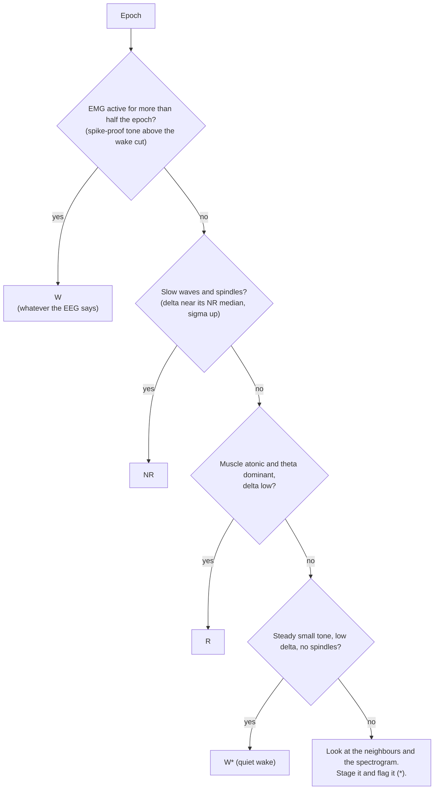

# Sleep scoring handbook: states, measures, values, conventions, literature

> [!abstract] TL;DR — for non-technical readers
> **What this is.** Everything a scorer needs to know to stage mouse sleep by hand and to defend
> each call: what wake, NREM and REM look like, what every number on the screen means and in which
> unit, what values are normal, the lab's scoring conventions, and the papers behind them.
>
> **Why it exists.** Every sleep result of the HLB SOD1 project rests on hand-scored epochs. A
> scorer who knows *why* an epoch is REM scores the same way on Monday and on Friday, and the same
> way as the next person. That consistency is what a kappa measures and what a reviewer asks about.
>
> **How to read this page.** §1 (the three states) and §3 (the decision flow) are the at-a-glance
> parts: read them before every session. §2 explains each measure once; search it when a word blocks
> you. §4 is our conventions, **drafts until the professor confirms them**. §5 is a library of real
> cases from our data. §6–§7 are the literature. §8 is the running list of questions for the
> professor. How to drive the program: [[sleepstager-user-guide]].
> Big picture: [[nvr-system-overview]].

The general-purpose dictionary of the analysis pipeline is [[eeg-analysis-glossary]];
this page is about **scoring**.

---

## 1. The three states in a mouse — at a glance

| | **Wake (W)** | **NREM (NR)** | **REM (R)** |
|---|---|---|---|
| **EMG (neck muscle)** | tone present; big bursts when moving, a steady lower tone when still | low and steady; occasional twitches | **lowest of all (atonia)**; brief phasic twitches |
| **EEG trace** | small, fast, irregular ("desynchronised") | **large, slow waves**; spindles | small, **regular ≈6–9 Hz rhythm** (θ) |
| **Spectrum** | flat-ish, more γ; θ appears during exploration | **δ (1–4 Hz) dominates**; σ (spindles) present | **θ peak**, δ low, σ low |
| **Spectrogram look** | dark δ band | **bright δ band** | bright line at θ over a dark δ band |
| **HLBSSL33 R medians**¹ | EMG 27 µV · tone 25 µV · δ 1k µV² · θ/δ 0.87 · σ 332 · γ frac 0.08 · total 3k · peak 5 Hz | EMG 7 · tone 6 · δ **4k** · θ/δ 0.49 · σ **640** · γ frac 0.03 · total **7k** · peak 3 Hz | EMG **6** · tone 6 · δ **0.8k** · θ/δ **2.07** · σ 274 · γ frac 0.07 · total 3k · peak **7 Hz** |
| **Share of 24 h (HLBSSL33 R)**² | 44 % | 48 % | 7 % |
| **Easy to confuse with** | NREM, when the mouse is still (quiet wake) | wake (drowsy, sleep onset); REM edges | **active wake** (it also has θ: the EMG decides) and quiet wake (both low δ) |

¹ Per-epoch medians of each stage in HLBSSL33 Recovery 2026-09-21 (rule first pass + 8 corrections,
2026-10-07), as the dossier prints them. They are **this mouse's** values; another mouse, another
electrode, other numbers. ² Rule first pass, 21,600 epochs.

> [!tip] The two questions, in this order
> 1. **Awake or asleep?** Look at the **EMG**.
> 2. **If asleep, NREM or REM?** Look at the **EEG**: δ and spindles mean NREM, θ with low δ means REM.
>
> At arousals and stage edges, check the call with **σ** (spindles) and **γ** (activation), because
> movement corrupts δ.

---

## 2. The measures, explained

### Units at a glance

| Symbol | Name | Used for |
|---|---|---|
| **µV** | microvolt, one millionth of a volt | raw EEG/EMG, EMG RMS, spike-proof tone. The amplifier's step is 0.195 µV |
| **µV²** | microvolt squared | **band power** (the dossier's `δ 4k` = 4,000 µV²). Legacy `.3eg` files give ADC² instead |
| **µV²/Hz** | power spectral density | the spectrogram's colours (log scale) |
| **Hz** | hertz, cycles per second | bands, peaks |
| **s** | second | epochs (4 s), windows |
| — | no unit (a ratio) | θ/δ, γ fraction, θ sharpness |
| **p0–p100** | percentile | the dossier's `pct` column |
| **%** | percent | time in stage |

### The time units

**Epoch.** The 4-second block that gets one stage. At 1000 samples per second it holds 4,000 samples.
**Majority rule:** the epoch gets the state that fills more than half of it.

**ZT (Zeitgeber time).** Hours since lights-on. ZT0 = 09:00 (lights on), ZT12 = 21:00 (lights off).
Mice are nocturnal: they sleep mostly in the **light phase (ZT0–12)** and are mostly awake in the dark.

**Windows (`28 s`, `±8 s`).** Some features are averaged over neighbouring epochs so one noisy epoch
cannot swing a call. The dossier's `28 s` column is this epoch ±3 epochs; the rule uses ±2 epochs
(±8 s). Both are **geometric means** (the mean of the logarithms), which an outlier moves less.

### The signals

**EEG.** Voltage between two screws over the cortex (the rig's signals are bipolar, already
differenced in hardware). Tens to hundreds of µV.

**EMG.** Voltage between two wires in the neck muscle. It measures **muscle tone**. Few to tens of µV
after filtering. On our rig the **heartbeat** often shows in it as small regular spikes (≈9 per
second, ≈540 beats per minute).

### Power and the frequency bands

**Power spectrum (PSD).** How the signal's energy is spread over frequencies. SleepStager computes
it per epoch with Welch's method: 1-s Hann windows, 50 % overlap, so 1-Hz-wide bins.

**Band power.** The sum of the 1-Hz bins inside a band, in µV². Read it as "how much of the signal's
energy lives in this frequency range". **Absolute power depends on the electrode** (placement,
impedance), so compare it **within one mouse only**.

| Band | Range in SleepStager | What it means for scoring |
|---|---|---|
| **δ (delta)** | 1–4 Hz (low δ 1–2, high δ 3–4) | **slow waves of NREM**; high in NREM, low in W and R |
| **θ (theta)** | 6–9 Hz | **REM** (and active, exploring wake). Generated in the hippocampus; the cortical screw picks up a weaker copy |
| **σ (sigma)** | 10–15 Hz | **sleep spindles**, bursts of 10–15 Hz waves from the thalamus. **NREM only**; rises just before REM |
| **β (beta)** | 15–30 Hz | fast activity; rarely decides a call |
| **low γ (gamma)** | 30–50 Hz | **activated cortex** (W, R). Muscle activity near the skull leaks in here too |
| **total** | 1–25 Hz | NREM has the most (big slow waves); W and R much less |

Other papers use slightly different edges (δ 0.5–4, θ 5–9 or 6–10 Hz). The exact edges of a saved
pass are in its JSON.

### The ratios and spectral descriptors

**θ/δ (theta over delta).** θ power divided by δ power. No unit. Above ~1, θ dominates (**REM**);
around 0.5 or below, δ dominates (**NREM**); wake sits between (≈0.9 here, because δ is low in wake
too). The rule uses it averaged over ±8 s on a log scale and fits its cut **per recording** (the 82nd
percentile of the sleep epochs): HLBSSL33 R → **0.92**.
*Pitfalls:* a ratio of two small numbers is noisy when total power is low; movement adds slow
artifact, which raises δ and pulls θ/δ down (epochs 333, 617).

**γ fraction.** Power 30–50 Hz divided by power 1–50 Hz. W ≈0.08, R ≈0.07, NR ≈0.03 in HLBSSL33.
High = activated cortex. *Pitfall:* during a big EMG burst some of it is muscle. Low γ during
movement is trustworthy (the cortex really was not activated).

**θ sharpness.** The power of the θ peak bin divided by the mean power over 5–10 Hz. 1 = no peak;
higher = a clear θ peak. REM 2.12 vs W/NR 1.81 here.

**Peak frequency.** The strongest 1-Hz bin between 1 and 15 Hz: ≈3 Hz in NREM, ≈7 Hz in REM.
**θ peak:** the strongest bin between 5 and 10 Hz (≈7 Hz in REM).

### Muscle tone: RMS, spike-proof tone, the wake cut

**RMS (root mean square).** Square every sample, average, take the square root. Unit µV. For a signal
that wiggles around zero it equals the standard deviation: **the typical size of the wiggle**. The
EMG RMS ("EMG", "tone", "muscle tone" on screen) is computed on the **20–90 Hz** band (where muscle
lives) over the **whole epoch**. Because samples are squared, **a short burst dominates it**.

**Spike-proof tone (`emg_tone_med`).** Slide a 0.5-s window across the epoch in 0.1-s steps
(≈36 windows), take the RMS of each, keep the **median**. A burst only moves the median if it
covers **more than about half** of the windows. It answers "was the muscle active **for most of**
the epoch?"

| Example: quiet floor 6 µV, then a 1-s burst at 40 µV | Result |
|---|---|
| EMG RMS = √((3 s × 6² + 1 s × 40²) / 4 s) | **≈ 21 µV**, above a wake cut of 13: looks like wake |
| spike-proof tone: ≈26 of 36 windows are quiet → median | **≈ 6 µV**, sleep level: it was a twitch |

**Wake cut (`emg_cut`).** The Otsu threshold on the EMG RMS: the value that best splits the
recording's epochs into a low group (sleep) and a high group (wake). Fitted per recording:
HLBSSL33 R → **13.3 µV**.

> [!warning] Our mains is 60 Hz, SleepStager notches 50 Hz
> The 20–90 Hz EMG band contains the 60 Hz mains, and the program only removes 50 Hz. In HLBSSL33 R,
> 60 Hz is **18 % of the NREM EMG power and 22 % of REM** (1.7 % of wake). The sleep floor reads
> slightly high (NR 6.5 instead of 5.9 µV). Item 1 of
> [[sleepstager-changes-and-backlog|the backlog]].

### Reading the panel and the dossier

**Percentile (`pct`).** The share of this recording's epochs with a lower value. p50 = the median.
**Median (W / NR / R columns).** The middle value of each stage in this recording, i.e. "where this
stage typically sits here". The references leave out clipped (`rail`) epochs and outliers.
**Feature sliders.** Each row spans this recording's p0–p100. The coloured bands are where its W, NR
and R epochs sit; the dot is the current epoch.
**Log scale.** The EMG-tone lane and the rule's θ/δ are on log scales: equal steps mean equal *ratios*.
**Rail.** The amplifier hit its limit (flat tops): a wire artifact, left out of every reference.
**`label_source`.** `rule` (the first pass), `restaged` (you changed it), `loaded`, `inherited`, `none`.
**`U` / padding.** Unstaged; epochs where the recorder was not running.

---

## 3. The decision flow

The same in words:

1. **EMG first.** Muscle active for more than half the epoch → **W**, even if δ looks high (movement fakes δ).
   Exception (C12): a lone 4-s epoch inside NREM whose EEG stays NREM is kept NR.
2. **If the muscle is quiet for most of the epoch, read the EEG over the quiet part.**
   Large slow waves, δ near its NREM median, σ up → **NR**.
3. **Atonic, θ dominant, δ low → R.** Weak θ alone is not a reason to leave REM (§4 C5).
4. **Quiet muscle but some steady tone, low δ, no spindles → W\*** (quiet or drowsy wake). Inside a wake bout → **W** (C11).
5. **Still unsure → stage it, flag it (`Shift+W/E/R`), and write it down for the professor (§8).**
6. **Check the epoch's neighbours.** Stages come in bouts; a lone odd epoch needs a reason.

---

## 4. Our conventions (DRAFT — to be confirmed by the professor)

> [!info] Also in SleepStager, as the "scoring rules" card under the feature sliders (local, Andrea's copy only)
> §3 and this table, shortened, live in `_RulesCard` in `SleepStager/sleepstager/viewer.py` (`DECIDE`, `EDGES`, `CHECK`).
> When a convention changes here, change the card too.

Written 2026-10-07 during the first session on HLBSSL33; C11–C12 and the ↳ rows added 2026-10-08 (session 2, epochs 840–8441). **None is adopted until the professor
confirms it.** When she does, change *status* and the date. Each one is applied the same way to every mouse.

| # | Convention | Example | Status |
|---|---|---|---|
| **C1** | One stage per **4-s epoch**, by **majority** (the state that fills more than half of it) | — | proposed |
| **C2** | **Arousals.** EMG activity for **more than half** the epoch → **W**. Less than half → keep the surrounding stage (a **microarousal**). The dossier's spike-proof tone vs the wake cut is the number for this. *Labs define microarousals anywhere from <10 s to ≤20 s (§6); the length that counts as one is still to choose* | 164, 433, 682 stay NR · 617 is W | proposed |
| **C3** | **NREM onset** is where **δ (slow waves) appears** in the EEG and spectrogram, not where the EMG drops | sleep onset ≈113 (EMG) vs ≈118 (δ) | **decided by Andrea 2026-10-07**, to confirm |
| **C4** | **REM onset** is the first epoch where **θ dominates and δ has dropped**; the epoch before, mixed, stays NR. Rising σ in late NREM announces it (Bandarabadi 2020) | 309 NR, 310 R · 3826 R | proposed |
| | ↳ *2026-10-08, Andrea:* the first epoch with **θ > δ, σ dropped and atonic muscle** is R even when the rule says NR: the rule reads θ/δ and δ over ±3 epochs, so it starts REM late (94 NR→R corrections in one session). **θ > δ alone is not enough**: with σ at NR level (spindles) it stays NR | 3826 R; 3820, 3822 NR | **decided by Andrea**, to confirm |
| **C5** | **REM end:** REM continues until **δ returns (→ NR)** or **muscle tone returns (→ W)**. Fading θ alone does not end REM | 331–332 → R\*; 767 → W\*; 1271, 2754, 4093–4114 R | proposed |
| **C6** | **During movement, ignore δ and θ/δ** (artifact). Judge the brain state with **σ** (spindles gone = left NREM) and **γ** | 333, 617 | proposed |
| | ↳ *2026-10-08:* **movement artifact at R→W** (slow swing on the EMG, then a 2-mV slow wave on the EEG) → W from the first moving epoch. **Electrode pops** (one step of several mV, exponential decay over ~200 ms, EEG only) → stage by the muscle, not X; the epoch's spectral numbers mean nothing | 3915, 3917 W; 2002, 2137 W | proposed |
| **C7** | **Minimum REM length.** Options: accept one epoch, or require ≥2 epochs (8 s); a shorter REM-like run becomes NR\*. *The program currently relabels REM ≤8 s inside NREM as NR.* Note: most C57BL/6 REM bouts are 1–2 epochs (McShane 2010), so a strict minimum removes many | 764–766 | **open, professor's choice** |
| **C8** | **Wake inside REM (R→W→R):** W epochs with sustained tone are scored **W**. Whether two REM bouts separated by a short W count as one *episode* is decided at **analysis**, the same way for every mouse. **W→R after a brief awakening inside a REM period** (normal in wild-type: Fujiki 2009, McShane 2010) is counted separately from **W→R after ≥40 s of wake** (the narcolepsy-like pattern, Scammell 2009) | 836–840 | proposed |
| **C9** | Use **flags** (`*`) for staged-but-doubtful epochs; **X** only for epochs that cannot be staged at all (artifact) | — | proposed |
| **C10** | **Transition tags (`t`)** only on clean transitions (both sides sustained, no doubt), never on uncertain edges | 310 tagged; 333, 334 not | proposed |
| **C11** | **Quiet wake inside a wake bout.** Epochs where the tone dips **under the wake cut** but the EEG stays at W level (δ ≈1k, no spindles, γ up) and the neighbours are W → **W**. The rule calls them NR: the biggest single correction (122 NR→W in one session) | 2240–2241, 5002–5003 | **decided by Andrea 2026-10-08**, to confirm |
| **C12** | **One-sided arousals inside NREM stay NR** (a 4-s epoch inside NR). If only the **muscle** wakes (tone above the cut, δ and σ still NR) or only the **EEG** wakes (δ and σ drop, tone under the cut) → **NR**. W only when both agree. Refines C2. *Open: 2971 was scored W with tone 12.6 just under the cut, against 1317 NR; settle one way* | 1321, 1323 NR; 1316–1317, 1452, 2695–2696 NR | **decided by Andrea 2026-10-08**, to confirm |

---

## 5. Case library (HLBSSL33, sessions 1–2)

Each case has its screenshots, the question asked and the reasoning in the journal:
[[2026-10-07]]. The pattern in one line:

| Pattern | How it looks | What to do | Case |
|---|---|---|---|
| Muscle burst inside NREM | EMG burst under half the epoch, δ and σ stay at NREM level | NR (microarousal), `space` | 433, 682, 164, 338 |
| Twitches at sleep onset | repeated short bursts in the first minutes of NREM, slow waves throughout | NR | 133–134 |
| Clean NREM → REM | θ rises, δ falls, muscle already atonic; one mixed epoch before | NR, then R; tag `t` on the first R | 309–310 |
| REM tail labelled NR | atonic, δ at W/R level (≈1k), θ fading, no spindles | **R\*** (C5) | 331–332 |
| Tone returns after REM | steady (not bursty) tone above the NR level, δ still low, σ at the bottom | **W\*** | 334, 767 |
| Short wake run inside NREM | burst covers most of the epoch, σ collapses | W (counts as a brief awakening) | 617 |
| Short REM episode | 3–4 epochs of θ-dominated, atonic, low-δ EEG inside NREM, ending in an arousal | R | 764–766 |
| REM → wake → REM | sustained tone for ~10 s mid-REM, no NREM between, back to REM | keep; flag the W→R. Normal in wild-type mice (Fujiki 2009) | 836–840 |
| Heartbeat in the EMG | small regular spikes ≈9/s on a flat EMG | ignore for staging | 431–432 |
| *Session 2, [[2026-10-08]]:* | | | |
| Quiet wake labelled NR | inside a W bout, tone just under the cut, δ ≈1k, no σ | W (C11) | 2240–2241, 5002–5003 |
| REM starts late | θ > δ, σ drops to the R level, atonic; the rule still says NR | R (C4) | 3826, 1009–1010 |
| θ dip inside REM | θ/δ falls to ≈0.6–1.1 but δ, σ and total stay low, atonic | keep R (C5) | 1271, 2754, 4093–4114 |
| Very quiet EMG in REM | raw EMG half the NR level, 60 Hz is 11–22 % of it, so the trace looks like hum | R; press `n` twice to see the atonia | 4093–4114 |
| One-sided arousal in NR | muscle only (tone above the cut, EEG NR) or EEG only (δ, σ drop, tone under) | NR (C12) | 1321, 1323, 1317, 1452, 2695 |
| Wake with movement after REM | EMG slow swing, then a 2-mV slow wave on the EEG | W from the first moving epoch (C6) | 3915–3923 |
| Electrode pop | EEG only: a step of several mV, exponential decay over ~200 ms | stage by the muscle (C6) | 2002, 2137 |

**The pattern behind most corrections so far:** the rule labels **NR** any sleep epoch it cannot call
REM. Check every NR epoch whose **δ is at W/R level** (the δ slider dot in the W band).

---

## 6. Numbers worth knowing (from the literature)

Every number below comes from a paper in §7 (abstract, or full text where marked). Our own
mouse's values are in §1.

| Topic                            | What the papers report                                                                                                                                                                                | Source                                                           |
| -------------------------------- | ----------------------------------------------------------------------------------------------------------------------------------------------------------------------------------------------------- | ---------------------------------------------------------------- |
| **There is no rodent standard**  | no agreed staging criteria exist for rodents; labs differ                                                                                                                                             | Rayan 2024                                                       |
| **Human vs human agreement**     | two scorers agreed on **92 %** of epochs (rats and mice, W/NREM/REM); REM is the weakest state (sensitivity 89 % for the automatic scorer)                                                            | Rytkönen 2011                                                    |
| **Automatic vs experts**         | 93–99 % agreement with experts from five labs                                                                                                                                                         | Miladinović 2019                                                 |
| **Agreement on transitions**     | **moderate to low** among eight experts, worst for **W→NREM** and **NREM→REM**; NREM→REM transitions last longest                                                                                     | Rahimi 2026                                                      |
| **Pre-REM (intermediate stage)** | an automatic scorer reaches F1 0.95 on W/NREM/REM but only **0.5** on pre-REM                                                                                                                         | Grieger 2021                                                     |
| **Before REM**                   | a few seconds of high-amplitude spindles plus low-frequency θ precede REM (rats, cats, mice); spindle rate rises **before REM onset but not before waking**                                           | Gottesmann 1996; Bandarabadi 2020; Vyazovskiy 2004; Franken 1998 |
| **Microarousals**                | definitions differ by lab: ≤16 s awakenings with EMG activity (Cardis 2021, full text), <15 s, ≤20 s counted as NREM, or EMG bursts <10 s; MAs **below 5 s** and **5–10 s** differ in cortical firing | Cardis 2021; Hauglund 2026                                       |
| **Cataplexy (narcolepsy)**       | abrupt neck atonia **≥10 s** with θ-dominated EEG and immobility, after **≥40 s of wake**; "almost never" in wild-type mice                                                                           | Scammell 2009                                                    |
| **W→REM in wild-type mice**      | happens, mostly in the light period, as a **brief wake breaking into a long REM episode**; requiring ≥4 consecutive 10-s wake epochs before REM gave 95.9 % specificity for the narcolepsy pattern    | Fujiki 2009; McShane 2010 (full text)                            |
| **REM bout lengths (C57BL/6)**   | most REM bouts were **1–2 epochs (4–8 s)**, with a tail to ~240 s                                                                                                                                     | McShane 2010 (full text)                                         |
| **NREM bouts (C57BL/6J)**        | 8 s to >512 s, mean 108.6 ± 8.1 s; ~63 % of the first 100 min after lights-on asleep                                                                                                                  | Lecci 2017 (full text)                                           |
| **Epoch length**                 | 4–10 s epochs have only minor effects on classifier performance; epoch length matters for **bout structure**, not for totals                                                                          | Brankačk 2010; McShane 2010                                      |
| **δ is not a fixed number**      | NREM δ (slow-wave activity) rises with the amount of prior wake, at a genotype-dependent rate; it rises after 10–30 min of spontaneous waking                                                         | Huber 2000; Franken 2001                                         |
| **Spindles by eye**              | marking spindles by hand in raw mouse EEG is unreliable (F1 0.26); use σ power instead                                                                                                                | Uygun 2019                                                       |
| **Strain matters**               | strains differ in sleep amount, timing and NREM fragmentation; compare with norms from the same strain                                                                                                | Franken 1999                                                     |

> [!tip] What these mean for scoring
> - **δ is relative.** NREM δ is highest early in the light phase and after deprivation, lower late in the
>   light phase. Judge δ against the neighbouring epochs and the time of day, not against one number.
> - **Rising σ in late NREM announces REM**, not waking. It helps place a REM onset (C4).
> - **Short REM bouts are normal** in C57BL/6. A strict minimum REM length (C7) would remove many of them.
> - **A W→R after a brief awakening inside a REM period is normal** in wild-type mice (C8). Only W→R after
>   long wake (≥40 s) is the narcolepsy-like pattern.
> - **Transitions are where experts disagree most.** Flag them rather than force them.

---

## 7. Literature

All verified in PubMed on 2026-10-07 (authors, journal, PMID, DOI). "Full text" = read in PubMed
Central, not only the abstract.

### Scoring criteria and methods
- **Rayan A et al., 2024.** Sleep scoring in rodents: criteria, automatic approaches and outstanding issues. *Eur J Neurosci* 59(4):526–553. PMID 36479908. [doi:10.1111/ejn.15884](https://doi.org/10.1111/ejn.15884) — **start here**: the review of criteria and automatic scorers; there is no agreed rodent standard.
- **Mang GM, Franken P, 2012.** Sleep and EEG phenotyping in mice. *Curr Protoc Mouse Biol* 2(1):55–74. PMID 26069005. [doi:10.1002/9780470942390.mo110126](https://doi.org/10.1002/9780470942390.mo110126) — a complete protocol: implantation, recording, state determination, spectral analysis.

### States, spectra and normal sleep in mice
- **Franken P, Malafosse A, Tafti M, 1998.** Genetic variation in EEG activity during sleep in inbred mice. *Am J Physiol* 275(4):R1127–37. PMID 9756543. [doi:10.1152/ajpregu.1998.275.4.R1127](https://doi.org/10.1152/ajpregu.1998.275.4.R1127) — θ peak frequency depends on genotype; δ and σ are anticorrelated in NREM; at 4-s resolution a >11 Hz peak precedes REM onset but not wake.
- **Franken P, Malafosse A, Tafti M, 1999.** Genetic determinants of sleep regulation in inbred mice. *Sleep* 22(2):155–69. PMID 10201060 — strains (B6 included) differ in sleep amount, timing and NREM fragmentation.
- **Huber R, Deboer T, Tobler I, 2000.** Effects of sleep deprivation on sleep and sleep EEG in three mouse strains. *Brain Res* 857(1–2):8–19. PMID 10700548. [doi:10.1016/s0006-8993(99)02248-9](https://doi.org/10.1016/s0006-8993(99)02248-9) — includes C57BL/6J; NREM slow-wave activity rises after 10–30 min of spontaneous waking.
- **Franken P, Chollet D, Tafti M, 2001.** The homeostatic regulation of sleep need is under genetic control. *J Neurosci* 21(8):2610–21. PMID 11306614. [doi:10.1523/JNEUROSCI.21-08-02610.2001](https://doi.org/10.1523/JNEUROSCI.21-08-02610.2001) — δ tracks prior wake, so it cannot be a fixed threshold.
- **McShane BB et al., 2010.** Characterization of the bout durations of sleep and wakefulness. *J Neurosci Methods* 193(2):321–33. PMID 20817037. [doi:10.1016/j.jneumeth.2010.08.024](https://doi.org/10.1016/j.jneumeth.2010.08.024) — many short bouts plus a tail of long ones; most B6 REM bouts are 1–2 epochs; W→REM in wild-type is a brief awakening inside sustained REM (full text).
- **Lecci S et al., 2017.** Coordinated infraslow neural and cardiac oscillations mark fragility and offline periods in mammalian sleep. *Sci Adv* 3(2):e1602026. PMID 28246641. [doi:10.1126/sciadv.1602026](https://doi.org/10.1126/sciadv.1602026) — NREM alternates every 20–25 s between fragile and offline phases (σ and heart rate); B6 NREM bout statistics (full text).

### Transitions: pre-REM, microarousals, W→REM
- **Gottesmann C, 1996.** The transition from slow-wave sleep to paradoxical sleep: the intermediate stage. *Neurosci Biobehav Rev* 20(3):367–87. PMID 8880730. [doi:10.1016/0149-7634(95)00055-0](https://doi.org/10.1016/0149-7634(95)00055-0) — REM is usually preceded by a few seconds of high-amplitude spindles plus low-frequency θ.
- **Vyazovskiy VV et al., 2004.** The dynamics of spindles and EEG slow-wave activity in NREM sleep in mice. *Arch Ital Biol* 142(4):511–23. PMID 15493552 — in C57BL/6, spindles (~11 Hz) increase before NREM→REM while slow-wave activity falls.
- **Bandarabadi M et al., 2020.** A role for spindles in the onset of rapid eye movement sleep. *Nat Commun* 11(1):5247. PMID 33067436. [doi:10.1038/s41467-020-19076-2](https://doi.org/10.1038/s41467-020-19076-2) — spindle rate rises before REM onset, not before waking.
- **Grieger N et al., 2021.** Automated scoring of pre-REM sleep in mice with deep learning. *Sci Rep* 11(1):12245. PMID 34112829. [doi:10.1038/s41598-021-91286-0](https://doi.org/10.1038/s41598-021-91286-0) — pre-REM is hard to score for machines and humans alike.
- **Rahimi S et al., 2026.** Characterizing transition state in mouse vigilance with EEG–EMG hypnodensity. *Sleep Adv* 7(3):zpag068. PMID 42602346. [doi:10.1093/sleepadvances/zpag068](https://doi.org/10.1093/sleepadvances/zpag068) — eight experts agree only moderately on transitions.
- **Cardis R et al., 2021.** Cortico-autonomic local arousals and heightened somatosensory arousability during NREMS of mice in neuropathic pain. *eLife* 10:e65835. PMID 34227936. [doi:10.7554/eLife.65835](https://doi.org/10.7554/eLife.65835) — microarousals = ≤16 s awakenings with EMG activity (full text); they cluster on a ~50 s infraslow rhythm.
- **Hauglund NL et al., 2026.** Cortical firing dynamics during micro-arousals vary with sleep/wake history and micro-arousal duration. *Sci Rep* 16(1). PMID 41922415. [doi:10.1038/s41598-026-45192-y](https://doi.org/10.1038/s41598-026-45192-y) — MAs <5 s and 5–10 s are physiologically different.
- **Scammell TE et al., 2009.** A consensus definition of cataplexy in mouse models of narcolepsy. *Sleep* 32(1):111–6. PMID 19189786 (PMC2625315) — cataplexy: ≥10 s atonia with θ, after ≥40 s of wake; the 40 s excludes REM after a brief awakening.
- **Fujiki N et al., 2009.** Specificity of direct transition from wake to REM sleep in orexin/ataxin-3 transgenic narcoleptic mice. *Exp Neurol* 217(1):46–54. PMID 19416673. [doi:10.1016/j.expneurol.2009.01.015](https://doi.org/10.1016/j.expneurol.2009.01.015) — wild-type mice also show W→REM, usually brief wake breaking into long REM.
- **Chemelli RM et al., 1999.** Narcolepsy in orexin knockout mice. *Cell* 98(4):437–51. PMID 10481909. [doi:10.1016/s0092-8674(00)81973-x](https://doi.org/10.1016/s0092-8674(00)81973-x) — the original narcoleptic mouse.

### Rhythms: spindles and θ
- **Fernandez LMJ, Lüthi A, 2020.** Sleep spindles: mechanisms and functions. *Physiol Rev* 100(2):805–868. PMID 31804897. [doi:10.1152/physrev.00042.2018](https://doi.org/10.1152/physrev.00042.2018) — thalamic origin; spindles are events inside a continuous σ band.
- **Uygun DS et al., 2019.** Validation of an automated sleep spindle detection method for mouse electroencephalography. *Sleep* 42(2):zsy218. PMID 30476300. [doi:10.1093/sleep/zsy218](https://doi.org/10.1093/sleep/zsy218) — spindles by eye in raw mouse EEG are unreliable; use σ power.
- **Buzsáki G, 2002.** Theta oscillations in the hippocampus. *Neuron* 33(3):325–40. PMID 11832222. [doi:10.1016/s0896-6273(02)00586-x](https://doi.org/10.1016/s0896-6273(02)00586-x) — where θ comes from and what it means.
- **Park SH et al., 2021.** A probabilistic model for the ultradian timing of REM sleep in mice. *PLoS Comput Biol* 17(8):e1009316. PMID 34432801. [doi:10.1371/journal.pcbi.1009316](https://doi.org/10.1371/journal.pcbi.1009316) — REM episodes cluster in short cycles; after REM comes a refractory period with frequent microarousals.

### Agreement and automatic scoring
- **Rytkönen KM, Zitting J, Porkka-Heiskanen T, 2011.** Automated sleep scoring in rats and mice using the naive Bayes classifier. *J Neurosci Methods* 202(1):60–4. PMID 21884727. [doi:10.1016/j.jneumeth.2011.08.023](https://doi.org/10.1016/j.jneumeth.2011.08.023) — human–human 92 %.
- **Miladinović Đ et al., 2019.** SPINDLE: end-to-end learning from EEG/EMG to extrapolate animal sleep scoring across experimental settings, labs and species. *PLoS Comput Biol* 15(4):e1006968. PMID 30998681. [doi:10.1371/journal.pcbi.1006968](https://doi.org/10.1371/journal.pcbi.1006968).
- **Barger Z et al., 2019.** Robust, automated sleep scoring by a compact neural network with distributional shift correction (AccuSleep). *PLoS One* 14(12):e0224642. PMID 31834897. [doi:10.1371/journal.pone.0224642](https://doi.org/10.1371/journal.pone.0224642) — standard z-scoring biases the time in each state.
- **Brankačk J et al., 2010.** EEG gamma frequency and sleep–wake scoring in mice: comparing two types of supervised classifiers. *Brain Res* 1322:59–71. PMID 20123089. [doi:10.1016/j.brainres.2010.01.069](https://doi.org/10.1016/j.brainres.2010.01.069) — γ and upper θ in REM help; epoch length 4–10 s matters little for classifiers.

> [!tip] A reading order for learning
> Rayan 2024 (the landscape) → Mang & Franken 2012 (the method) → McShane 2010 (what bouts look like)
> → Scammell 2009 + Fujiki 2009 (why W→R matters) → Rahimi 2026 (why transitions are hard).

---

## 8. Questions for the professor (running list)

Add to the list as they come up; mark the answer and the date when she explains. Each links to the
case in the journal.

1. **C2, microarousals:** is "more than half the epoch" the lab's rule? Should microarousals be
   counted, and with which minimum length? ([[2026-10-07#Case 3. Epoch 164, a microarousal|164]],
   [[2026-10-07#Case 7. Epoch 682, a similar burst that stayed NREM|682]])
2. **C3, NREM onset:** δ appearance (our choice) or EMG drop?
   ([[2026-10-07#Case 2. Epoch 134, twitches at sleep onset|134]])
3. **C5, REM end:** is an atonic, low-δ epoch after the θ fades still REM?
   ([[2026-10-07#Case 5. Epochs 331 to 340, the end of a REM bout|331–332]])
4. **C7, minimum REM:** is a one-epoch REM real? A 3-epoch episode?
   ([[2026-10-07#Case 8. Epochs 764 to 767, a short REM episode|764–766]])
5. **C8, R→W→R:** how does the lab count a REM episode interrupted by ~10 s of wake?
   ([[2026-10-07#Case 9. Epochs 836 to 840, REM then wake then REM|836–840]])
6. **Borderline arousal:** 617's spike-proof tone is 13.4 against a cut of 13.3. W or NR\*?
   ([[2026-10-07#Case 6. Epoch 617, a short wake run|617]])
7. **The 60 Hz notch:** should SleepStager notch 60 Hz for our rig before more mice are scored?
   ([[sleepstager-changes-and-backlog|backlog 1]])
8. **Validation:** is checking only the rule's marks and the REM edges acceptable, or must every
   epoch be read? (Proposed test: score ZT0–2 completely and count unmarked changes.)
9. **C12, one-sided arousals:** in NREM, does a 4-s epoch count as W when only the muscle wakes (1321, 1323) or only the
   EEG wakes (1317, 1452, 2695–2696)? Is there a minimum arousal length? ([[2026-10-08]])
10. **C7, a mixed epoch inside a short REM bout:** 1008 (δ and σ back near NR) between R epochs: R or NR? ([[2026-10-08]])
11. **C11, quiet wake:** is an epoch with tone under the cut, W-level EEG and W neighbours scored W or W\*? ([[2026-10-08]])
12. **The rule starts REM late** (±3-epoch smoothing): worth a rule proposal? 94 NR→R corrections in one session. ([[2026-10-08]])
13. **EEG spikes at 2002 and 2137:** electrode pops or building interference? Check another mouse at 11:13:25 and 11:22:25 KST.

---

## Related

- [[sleepstager-user-guide]] — driving the program
- [[sleepstager-changes-and-backlog]] — program changes and backlog
- [[eeg-analysis-glossary]] — the pipeline's dictionary
- [[blind-scoring-and-kappa]] — measuring agreement with a human scorer
- [[sleepyscore-japan-scoring-tool-algorithm]] — the older tool's algorithm
- [[is-our-qc-approach-sound]] — the literature check on our QC
- [[_HLB-SOD1-project-hub]] — the project these scorings serve
